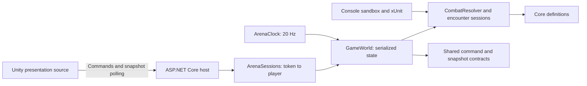

# Architecture and ownership

## Current project boundaries

| Project / source | Target | Owns | Dependencies |
| --- | --- | --- | --- |
| `Relicbound.Core` | .NET Standard 2.1, C# 8 | Immutable ability, damage, chain, reaction, loadout, encounter, and progression definitions | No project dependencies |
| `Relicbound.Contracts` | .NET Standard 2.1 | Mutable serializable command/reply/snapshot DTOs | No project dependencies |
| `Relicbound.Simulation` | .NET 10 | Mutable combatants, resolver, encounter sessions, deterministic arena | Core, Contracts |
| `Relicbound.Sandbox` | .NET 10 | Scripted console demonstration and optional combat event output | Simulation |
| `Relicbound.Server` | .NET 10 / ASP.NET Core | HTTP endpoints, ephemeral sessions, 20 Hz clock | Simulation (Contracts transitively) |
| `Relicbound.Simulation.Tests` | .NET 10 / xUnit | Domain and arena regression tests | Simulation |
| `Relicbound.Server.Tests` | .NET 10 / xUnit | HTTP auth, retry, expiry, and concurrency tests | Server, ASP.NET Core test host |
| `client/Relicbound.Unity` | Unity source import kit | Camera, primitive visuals, controls, HTTP transport | Copied Contracts source, Unity APIs |
| `RelicBound` | .NET 10 / ASP.NET Core | Preserved original web starter | Not integrated with gameplay |

Core is the engine compatibility boundary. Simulation runs on the server and
does not need to run in Unity. The current Unity import kit only consumes
Contracts, not Core or Simulation. The intended Blazor companion and SQL Server
storage are future parts of the architecture, not working integrations.

## Definitions, state, and execution

Definitions describe mechanics as data. Constructor validation and defensive
collection copies prevent callers from altering an existing definition. There is
no JSON content loader yet. Sample catalogs are declared in Sandbox and GameWorld;
they are not a centralized production content registry.

Combatant owns health, barrier, resource, ability readiness, personal discovery
and mastery unlocks, chain progress, completed encounters, and equipped relic ID.
Definitions do not own runtime health or cooldowns. Relic IDs are not inventory
instances and do not establish ownership.

CombatResolver offers three levels of trust:

| Entry point | Behavior and caller responsibility |
| --- | --- |
| `Resolve(ability, modifiers)` | Compose a damage/chain/reaction plan without applying it; does not expand reactions or check character unlocks |
| Entity-aware `Resolve(...)` | Validate and commit a bounded combat action using trusted supplied modifiers and candidate targets |
| `ResolveLoadout(...)` | Look up selected IDs in a trusted catalog, check personal unlocks, execute combat, and award qualifying mastery credit |

The contextual reaction overload accepts trusted host rules, such as cooperative
shatter. No HTTP command accepts arbitrary damage amounts, reaction definitions,
health, unlock grants, or attacker identity.

## Command-to-result lifecycle

1. ArenaSessions resolves the bearer token to its server-issued player ID.
2. GameWorld serializes the command with its lock and checks sequence/liveness.
3. The command handler checks range, world prerequisites, and permitted IDs.
4. CombatResolver assembles contributions and targets, validates pacing, expands
   bounded events, and computes action snapshots before committing combat state.
5. GameWorld records combat events and checks applicable encounter completion.
6. The client receives an acknowledgement, then polls detached world snapshots.

Resolver atomicity covers validation, event expansion, resource/cooldown commit,
health, and barriers for that combat action. It is not a database transaction or
a rollback system for arbitrary world commands. Failed gameplay commands consume
their command sequence and cache their failure even when combat state is unchanged.

## Concurrency and determinism

GameWorld guards join, disconnect, commands, ticks, and snapshots with one lock.
ArenaSessions separately guards session lookup and removal, then calls GameWorld;
the clock only enters GameWorld. Direct Combatant/CombatResolver use is not thread
safe: callers must serialize access. Returned snapshots copy mutable DTOs so a
consumer cannot mutate authoritative state through a snapshot.

Replayability means the same initial state, ordered commands, and ticks yield the
same outcomes. Stable target ordering, integer values, and FIFO reaction ordering
support this. Network arrival order, token generation, wall-clock scheduling,
and session expiry are outside deterministic simulation. There is no persisted
replay log or client prediction. PeriodicTimer advances one logical tick per
delivered timer iteration; the host does not implement elapsed-time catch-up.

## Lifetime and limitations

GameWorld and ArenaSessions are singleton services for one process/arena.
ArenaClock is a hosted service and stops through cancellation. All character and
world data disappears on server restart. Disconnect removes the character;
creating another session creates a new character. There is no account recovery,
revival, room matchmaking, database schema, loot ownership, or transaction system.

The client uses request timeouts, disposes HTTP requests, and polls every 0.1
seconds after each response. The host continues simulating independently of
rendering. Unity lifecycle and presentation behavior still require Editor testing.
